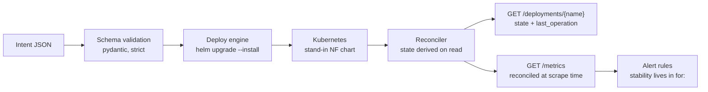

# nf-orchestrator

[](https://github.com/poggymacello/nf-orchestrator/actions/workflows/ci.yaml)
[](LICENSE)


An intent-driven orchestrator for network functions on Kubernetes. It validates a declarative intent,
deploys it with Helm, reports lifecycle state derived from live cluster signals, and exposes
Prometheus metrics and alert rules that have been hardened through fifteen staged failure drills.

> **Scope.** This is a **self-directed learning project**: a generic re-implementation, built only
> from public sources, of the pattern behind SMO-driven network function orchestration in O-RAN. It
> runs on one machine against one `kind` cluster. It is not a production O-Cloud, and the deployed
> workload is a generic stand-in network function, not vendor software. Scope and non-goals:
> [overview](docs/design/00-overview.md).

## Contents

- [Highlights](#highlights)
- [Architecture](#architecture)
- [Requirements](#requirements)
- [Quickstart](#quickstart)
- [Configuration](#configuration)
- [API](#api)
- [Observability](#observability)
- [Reliability: failure drills](#reliability-failure-drills)
- [Engineering decisions](#engineering-decisions)
- [Development](#development)
- [Project status](#project-status)
- [Documentation](#documentation)

## Highlights

- **State derived, never stored.** `NOT_INSTANTIATED`, `INSTANTIATING`, `INSTANTIATED` and `FAILED`
  are computed from Helm history and live pod readiness on every read. The last operation is reported
  separately, following ETSI SOL003's split: a rejected upgrade is not a broken network function.
- **Every failure says whose it is.** A failed call is classified before it is answered: the cluster
  refused (`502`), throttled this client (`503` + `Retry-After`), was unreachable (`503`), or this host
  was overloaded, out of processes, or missing a tool. Each outcome has its own HTTP status, metric
  and alert.
- **Bounded everywhere.** Every cluster call has a wall-clock bound, and every scrape has one budget
  inside Prometheus's timeout. Releases a scrape could not read are named, not silently dropped.
- **Alerts that are tested.** Ten rules, each with a `for:` window, a severity and a runbook,
  unit-tested with promtool in CI against the series the drills produced.
- **Documentation that is tested.** Reference pages, README numbers, alert routing and every relative
  link are checked against the code in CI.

## Architecture



Components, the lifecycle model and the failure-classification order are in
[architecture](docs/design/architecture.md).

## Requirements

| | Version |
|---|---|
| Python | 3.11 or newer |
| Docker, [kind](https://kind.sigs.k8s.io/) | any recent |
| kubectl | within one minor version of the cluster |
| Helm | **4.x** (CI pins 4.2.2). Helm 3 does not refuse field-ownership conflicts |
| Kubernetes | tested on 1.34 and 1.35 |

## Quickstart

```bash
make install && make up
uvicorn orchestrator:app --port 8000
```

Then, in another shell. This is real output, not an illustration:

```
$ curl -s -X POST localhost:8000/deployments -H 'content-type: application/json' \
    -d '{"name":"sample-nf","replicas":2,"environment":"dev"}'
{"release":"sample-nf","status":"deployed","revision":1,
 "values":{"replicaCount":2,"environment":"dev"}}

$ curl -s localhost:8000/deployments/sample-nf          # a second later
{"release":"sample-nf","state":"INSTANTIATING","helm_status":"deployed",
 "desired_replicas":2,"ready_replicas":0,
 "last_operation":{"revision":1,"state":"COMPLETED","description":"Install complete"},
 "pods":[{"phase":"Pending","reason":"ContainerCreating","ready":false}, ...]}

$ curl -s localhost:8000/deployments/sample-nf          # once the pods are ready
{"release":"sample-nf","state":"INSTANTIATED","helm_status":"deployed",
 "desired_replicas":2,"ready_replicas":2,
 "last_operation":{"revision":1,"state":"COMPLETED","description":"Install complete"},
 "pods":[{"phase":"Running","reason":null,"ready":true},
         {"phase":"Running","reason":null,"ready":true}]}

$ curl -s localhost:8000/metrics | grep ^nf_
nf_cluster_reachable 1.0
nf_deployment_state{release="sample-nf",state="INSTANTIATED"} 1.0
nf_deployment_desired_replicas{release="sample-nf"} 2.0
nf_deployment_ready_replicas{release="sample-nf"} 2.0
nf_last_operation_state{release="sample-nf",state="COMPLETED"} 1.0

$ curl -s -X DELETE localhost:8000/deployments/sample-nf
{"release":"sample-nf","state":"NOT_INSTANTIATED","uninstalled":true}
```

The `/metrics` excerpt is from before the coverage and host series existed; the full list is in the
[metrics reference](docs/reference/metrics.md). `make down` deletes the cluster.

## Configuration

Environment variables, read at start-up. The two most often changed:

| Variable | Default | |
|---|---|---|
| `NF_KUBE_CONTEXT` | `kind-nf-orchestrator` | kubeconfig context for every call |
| `NF_SCRAPE_WORKERS` | `8` | Concurrent release reads per scrape; keep it within the cluster's flow-control allowance and the host's pids limit |

All eleven settings, with defaults and the reasoning behind them:
[configuration reference](docs/reference/configuration.md).

## API

| Route | |
|---|---|
| `POST /deployments` | Deploy a validated intent. `409` if another field manager owns a field it would change; it never forces |
| `POST /deployments/{name}/repair` | Deploy **and** take ownership of contested fields. Explicit, because it overrides whatever else was writing them |
| `GET /deployments/{name}` | Lifecycle state, the replica counts behind it, and the last operation |
| `DELETE /deployments/{name}` | Uninstall. Idempotent |
| `POST /intents/validate` · `GET /intents/schema` | Validate an intent without deploying · its JSON Schema |
| `POST /intents/translate` | Free text to a *candidate* intent that passes the same schema. Translating never deploys |
| `GET /healthz` · `GET /readyz` | Liveness · readiness (tools installed, API server answering) |
| `GET /metrics` | Prometheus exposition |

The status code says who failed and whether to retry: `500` this host is misconfigured, `502` the
cluster refused, `503` with `Retry-After` the cluster is throttling or this host is overloaded, `503`
without it the cluster is unreachable. Schemas, examples and the full error model:
[API reference](docs/reference/api.md).

## Observability

`/metrics` reconciles every release at scrape time, inside one 4-second budget, in waves that grow
while the cluster keeps up. Besides lifecycle state per release, it reports which releases it could
not read and why (`deadline`, `busy`, `host`), how the cluster answered its readiness probe, and the
condition of the orchestrator's own host. [Metrics reference](docs/reference/metrics.md).

Ten alert rules, with severities `page` and `warning`, each linking its runbook:
[alerts reference](docs/reference/alerts.md). Runbooks:
[operations](docs/operations/README.md#runbooks).

## Reliability: failure drills

Fifteen deliberate failure drills were run against real clusters. For each one the expected
behaviour was written down first, a blameless postmortem was written from the captured output, the
fix was verified by re-running the drill, and the runbooks were corrected where the drill proved them
wrong. Every one found the orchestrator, or the monitoring around it, reporting something false.

| Drill | What it found |
|---|---|
| [1 — pods killed mid-deploy](docs/operations/postmortems/2026-08-20-drill-1-pods-killed-mid-deploy.md) | `INSTANTIATED` reported with **one pod running for a three-replica intent** |
| [2 — control plane unreachable](docs/operations/postmortems/2026-08-20-drill-2-control-plane-unreachable.md) | A running NF reported as `NOT_INSTANTIATED` with **HTTP 200**, identical to a real teardown |
| [3 — repairing drift](docs/operations/postmortems/2026-08-26-drill-3-repairing-drift-outside-helm.md) | Repair failed on a server-side apply conflict, and a **still-serving workload read `FAILED`** |
| [4 — steering the translator](docs/operations/postmortems/2026-09-09-drill-4-steering-the-translator-with-text.md) | Injections were refused by the order of a tuple, not by design; "from staging to prod" became **staging** |
| [5 — disk pressure and eviction](docs/operations/postmortems/2026-09-12-drill-5-disk-pressure-and-eviction.md) | A **fully recovered** NF reported `FAILED` forever: evicted pods are never deleted |
| [6 — a frozen control plane](docs/operations/postmortems/2026-09-13-drill-6-frozen-control-plane.md) | Calls bounded only by Go's TLS default: **the outage alert had no data during the outage** |
| [7 — the scrape outgrows its budget](docs/operations/postmortems/2026-09-14-drill-7-the-scrape-outgrows-its-budget.md) | Twenty **healthy** releases took the scrape past its timeout and **paged that the orchestrator was down** |
| [8 — a slow API server](docs/operations/postmortems/2026-09-16-drill-8-a-slow-api-server.md) | Drill 7's concurrency left every release half-read on a slow cluster: **none** reported |
| [9 — the API server sheds load](docs/operations/postmortems/2026-09-17-drill-9-the-api-server-sheds-load.md) | Flow-control rejections (429) **reported as an outage** |
| [10 — the API server queues instead of refusing](docs/operations/postmortems/2026-09-23-drill-10-the-api-server-queues-instead-of-refusing.md) | Queued back-pressure looked like the orchestrator being slow, and the readiness probe was itself too slow to tell |
| [11 — the orchestrator's host is starved](docs/operations/postmortems/2026-09-24-drill-11-the-orchestrator-host-is-starved.md) | A busy orchestrator host **paged as a throttling cluster**; the real cause had no alert |
| [12 — a starved host and a frozen cluster](docs/operations/postmortems/2026-09-26-drill-12-a-starved-host-and-a-frozen-cluster.md) | The host alert **cleared mid-outage**, and the throttling alert came **two seconds from paging during an outage** |
| [13 — the same outage, with nothing scraping](docs/operations/postmortems/2026-09-27-drill-13-with-nothing-scraping.md) | The status route **blamed the orchestrator for a real outage**, and `/readyz` called a **healthy** cluster unreachable |
| [14 — a host that cannot start threads](docs/operations/postmortems/2026-10-06-drill-14-a-host-that-cannot-start-threads.md) | Under a pids limit, Go's thread failure was read as the cluster's reply: **an outage page**, `502` with 19 KB of stack, bare `500`s |
| [15 — the orchestrator cannot spawn its tools](docs/operations/postmortems/2026-10-16-drill-15-the-orchestrator-cannot-spawn-its-tools.md) | A missing helm and a full process table both **paged as a cluster outage**, and `/readyz` said **ready** with helm gone |

65 findings. Every defect is fixed and re-verified; twelve are limits, accepted and written down. One
more was accepted and then drilled, and turned out to be false.

Three lessons recur. Drills 1–3: two values that are usually equal were collapsed into one, and they
diverged only during an incident. Drills 6–8: a fix made for one cluster became the defect on
another. Drills 9–15: one exception class covered several different failures, so the default answer
blamed the cluster, the one component that was often fine. Process, severity model, runbooks and
every postmortem: [operations](docs/operations/README.md).

## Engineering decisions

Recorded as ADRs with the alternatives that were rejected and why, in
[`docs/design/adr/`](docs/design/adr/). The ones that shape the system most:

| | |
|---|---|
| [0005](docs/design/adr/0005-derive-lifecycle-state-from-cluster-signals.md) | Derive state on read, never store it |
| [0006](docs/design/adr/0006-instantiated-means-the-intent-is-satisfied.md) | `INSTANTIATED` means the intent is satisfied, and "unreachable" is not a state |
| [0007](docs/design/adr/0007-stability-is-an-alerting-concern.md) | Stability belongs in the alert rule's `for:` window, not the application |
| [0008](docs/design/adr/0008-forcing-field-ownership-is-an-explicit-operation.md) | The deploy path never forces conflicts; repair is a separate, named operation |
| [0009](docs/design/adr/0009-the-operation-is-not-the-network-function.md) | The operation is not the network function |
| [0014](docs/design/adr/0014-the-scrape-has-one-budget.md) | The scrape has one budget, and a release with no coverage is named |
| [0015](docs/design/adr/0015-admit-scrape-work-in-waves.md) | A scrape admits work in waves |
| [0016](docs/design/adr/0016-busy-is-not-unreachable.md) | A throttled cluster is busy, not unreachable |
| [0017](docs/design/adr/0017-reachability-needs-more-than-one-witness.md) | Reachability needs two witnesses |
| [0018](docs/design/adr/0018-the-probe-measures-two-ends.md) | The probe measures two ends: the cluster's round trip and this host's share |
| [0019](docs/design/adr/0019-alert-rules-are-tested-against-drill-series.md) | Alert rules are unit-tested against the drills' series |
| [0020](docs/design/adr/0020-an-inconclusive-probe-is-asked-again.md) | An inconclusive probe is asked again, not believed |
| [0021](docs/design/adr/0021-a-host-out-of-capacity-is-not-a-slow-host.md) | A host out of threads is its own failure, not a refusing cluster |
| [0022](docs/design/adr/0022-a-failed-spawn-is-classified-by-its-cause.md) | A failed spawn is classified by its cause |

## Development

249 unit tests, plus 6 end-to-end tests that drive the real API against a real cluster. CI runs
five jobs on every branch push:

| Job | |
|---|---|
| `lint-test` | ruff, the unit tests, and promtool over the alert rules |
| `secret-scan` | Gitleaks over the full git history |
| `banned-terms` | A private term list, supplied as a secret, never printed; fails closed |
| `vuln-scan` | Trivy over the chart and the dependency set, failing on HIGH and CRITICAL |
| `e2e` | A kind cluster on each of two pinned Kubernetes versions, Helm 4.2.2 |

```bash
make lint && make test      # no cluster needed
make rules                  # alert rules, with promtool in Docker
make up && make e2e         # the same command CI runs
```

Third-party actions are pinned to commit SHAs and scanner images to digests. Setup, workflow,
commit conventions and documentation standards: [CONTRIBUTING](CONTRIBUTING.md).

## Project status

Seven of eight milestones are complete. The eighth, the LLM intent layer, is built and drilled, but
its model-backed translator has not yet been run against the live API. Per milestone:
[milestone map](docs/milestone-map.md). Change history: [CHANGELOG](CHANGELOG.md).

Not built:

- **A live run of the model-backed translator.** `POST /intents/translate` uses the rule-based
  translator. A model-backed one sits behind the same protocol, tested against a fake client, and has
  never made a real API call
  ([ADR-0013](docs/design/adr/0013-the-claude-translator-is-opt-in-and-unverified.md)).
- **Authentication.** The API has none; it is a single-operator tool ([SECURITY](SECURITY.md)).
- **Push or event streams.** State is derived per read. A transition between two scrapes is never seen.
- **Multi-cluster, high availability, persistence.** One orchestrator, one cluster, no database.
- **A recorded rationale for FastAPI.** The choice predates the ADR habit and has not been
  reconstructed after the fact ([ADR-0001](docs/design/adr/0001-record-architecture-decisions.md)).

## Documentation

| | |
|---|---|
| [Reference](docs/reference/) | Configuration, API and error model, metrics, alerts. Checked against the code in CI |
| [Design](docs/design/) | Overview, architecture, lifecycle state model, and 21 ADRs |
| [Operations](docs/operations/README.md) | Severity model, runbooks, postmortems for every drill |
| [Build log](docs/build-log/) · [Daily log](docs/daily-log/) | What was built when, what broke, what was learned |
| [Learning notes](docs/learning-notes/) | FastAPI, JSON Schema, Helm and kind, Prometheus |

## Contributing, security, license

[CONTRIBUTING](CONTRIBUTING.md) · [SECURITY](SECURITY.md) (private vulnerability reporting is enabled)
· [CHANGELOG](CHANGELOG.md) · [MIT License](LICENSE)
