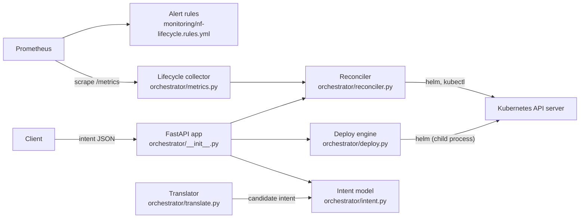
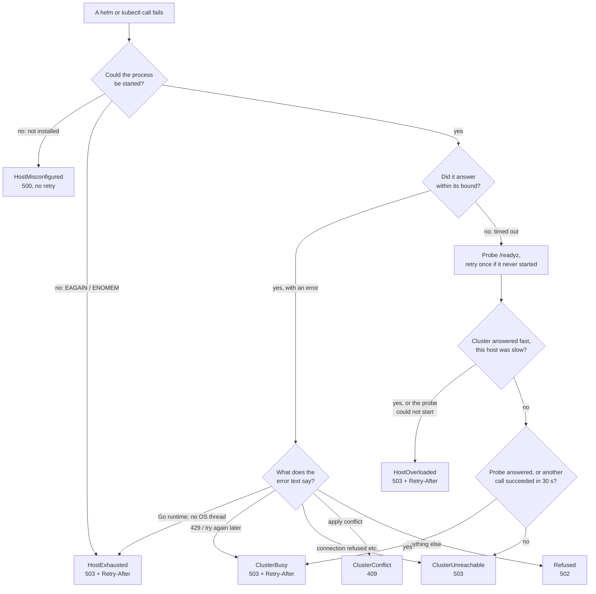

# Architecture

nf-orchestrator turns a validated intent into a Helm release on Kubernetes and reports the
release's lifecycle state from live cluster signals. This page covers the components, the request
path, how state is derived, and how the orchestrator decides **who** failed when something does.
Decisions are linked to the ADRs that record them.

## Components

| Component | Responsibility | Does not |
|---|---|---|
| **Intent model** | Strict validation of `name`, `replicas`, `environment`; rejects unknown fields and type coercion ([ADR-0003](adr/0003-intent-schema-contract.md)) | Touch a cluster. A `422` happens before any call |
| **Deploy engine** | Renders the intent to chart values and runs `helm upgrade --install`; runs every helm and kubectl call with a bound; classifies every failure | Force field ownership, except on the explicit repair route ([ADR-0008](adr/0008-forcing-field-ownership-is-an-explicit-operation.md)) |
| **Reconciler** | Derives lifecycle state from Helm history and live pod readiness on every read ([ADR-0005](adr/0005-derive-lifecycle-state-from-cluster-signals.md)) | Store state. There is no database |
| **Lifecycle collector** | Reconciles every release at scrape time inside one budget, in waves, and names releases it could not read ([ADR-0014](adr/0014-the-scrape-has-one-budget.md), [ADR-0015](adr/0015-admit-scrape-work-in-waves.md)) | Decide what is stable. That is the alert rules' `for:` ([ADR-0007](adr/0007-stability-is-an-alerting-concern.md)) |
| **Translator** | Turns free text into a *candidate* intent that must pass the same model ([ADR-0012](adr/0012-the-translator-is-untrusted-input.md)) | Deploy. Sending the candidate to `POST /deployments` is a separate call |

The deploy engine shells out to the `helm` and `kubectl` binaries rather than using client libraries
([ADR-0004](adr/0004-helm-as-the-deploy-mechanism.md)). Helm 4 applies server-side, so a field
another manager owns is refused rather than overwritten, and the API returns `409`.

## Lifecycle state

The state describes the network function; what happened to the last Helm operation is reported
separately, because a rejected upgrade is not a broken workload
([ADR-0009](adr/0009-the-operation-is-not-the-network-function.md)).

| Field | Derived from |
|---|---|
| `state`: `NOT_INSTANTIATED`, `INSTANTIATING`, `INSTANTIATED`, `FAILED` | Whether a release exists, and whether the replicas the intent asked for are ready ([ADR-0006](adr/0006-instantiated-means-the-intent-is-satisfied.md)) |
| `last_operation.state`: `PROCESSING`, `COMPLETED`, `FAILED`, `UNKNOWN` | The newest Helm history entry |
| `desired_replicas` | The values of the last revision in effect, not the last one submitted |

The model, and its grounding in ETSI SOL003 and O-RAN O2, is in
[lifecycle states](lifecycle-states.md).

## Bounds and budgets

Every helm and kubectl call is a child process with a wall-clock bound: 3 s for reads, 60 s for
writes. A scrape has one 4 s budget, inside Prometheus's 5 s timeout, and admits work in waves that
grow while they finish. These numbers are configurable; see the
[configuration reference](../reference/configuration.md).

## Failure classification

When a call fails, the orchestrator decides whose fault it is before it answers. The order matters:
each step was added because an earlier one blamed the wrong component in a drill.

| Outcome | Means | Introduced by |
|---|---|---|
| `HostMisconfigured` | helm or kubectl missing or not executable | [ADR-0022](adr/0022-a-failed-spawn-is-classified-by-its-cause.md), drill 15 |
| `HostExhausted` | No process or thread could be created (pids or memory limit) | [ADR-0021](adr/0021-a-host-out-of-capacity-is-not-a-slow-host.md), drill 14 |
| `HostOverloaded` | This host was too slow; the cluster's own round trip was fast | [ADR-0018](adr/0018-the-probe-measures-two-ends.md), [ADR-0020](adr/0020-an-inconclusive-probe-is-asked-again.md), drills 11 and 13 |
| `ClusterBusy` | The cluster is up and not serving this client: throttled or queueing | [ADR-0016](adr/0016-busy-is-not-unreachable.md), [ADR-0017](adr/0017-reachability-needs-more-than-one-witness.md), drills 9 and 10 |
| `ClusterUnreachable` | Nothing answered, and no recent evidence that the cluster is there | [ADR-0006](adr/0006-instantiated-means-the-intent-is-satisfied.md), drills 2, 6, 7 |
| `ClusterConflict` | Another field manager owns a field this intent would change | [ADR-0008](adr/0008-forcing-field-ownership-is-an-explicit-operation.md), drill 3 |

The **readiness probe** is one `kubectl get --raw=/readyz` at `-v=6`. kubectl's own log gives two
numbers from that one process: the API server's round trip, which is the cluster's time, and the time
before kubectl started, which is this host's. Answers are cached for 2 s so that calls failing
together share one probe.

Each outcome maps to one HTTP status and one place in `/metrics`. See the
[API error model](../reference/api.md#error-model) and the [metrics reference](../reference/metrics.md).

## Monitoring

`/metrics` is computed at scrape time: Prometheus is the poller. Ten alert rules turn the series into
pages and warnings. Every rule has a `for:` window and a `runbook_url`, and every rule is unit-tested
with promtool against the series the drills produced
([ADR-0019](adr/0019-alert-rules-are-tested-against-drill-series.md)). See the
[alerts reference](../reference/alerts.md).

## Not in this design

- **Persistence.** Helm's release history is the only record that an intent was submitted.
- **A background controller.** Nothing watches the cluster continuously. A transition between two
  scrapes is never seen.
- **Multiple clusters, high availability, authentication.** One orchestrator, one kubeconfig context,
  no access control on the API. This is a single-operator lab tool.
